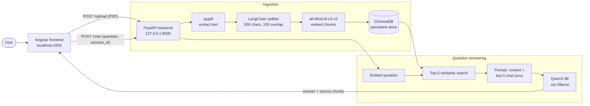

# AI Document Q&A (Local RAG)

Upload a PDF, ask questions in plain English, and get answers grounded in the document, with source chunk references. Everything runs on your machine: embeddings, vector search and the LLM (Qwen3 4B via Ollama). No document data is sent to a cloud API.


## System Architecture



**Ingestion:** the PDF text is split into overlapping chunks, embedded with `all-MiniLM-L6-v2`, and stored in ChromaDB. Uploading a new PDF replaces the previous one.

**Answering:** the question is embedded, the 5 nearest chunks are retrieved, and they are combined with the last 5 turns of that session's history into a prompt for Qwen3. The response returns the answer plus the filename and chunk number of each source.

## Tech Stack

| Layer | Tools |
|---|---|
| Frontend | Angular 21, TypeScript |
| Backend | FastAPI, pypdf, LangChain text splitters |
| Embeddings | Sentence Transformers (`all-MiniLM-L6-v2`) |
| Vector DB | ChromaDB (persistent, `backend/chroma_db/`) |
| LLM | Qwen3 4B served by Ollama |

## Run Locally

**Prerequisites:** Python 3.11+, Node.js, and [Ollama](https://ollama.com) with the model pulled:

```bash
ollama pull qwen3:4b
```

**Backend** (http://127.0.0.1:8000, Swagger at `/docs`)

```bash
cd backend
python -m venv .venv
.venv\Scripts\activate        # macOS/Linux: source .venv/bin/activate
pip install -r requirements.txt
uvicorn app.main:app --reload
```

**Frontend** (http://localhost:4200)

```bash
cd frontend
npm install
npm start
```

Open http://localhost:4200, upload a PDF, then ask a question.

> The embedding model is downloaded from Hugging Face on first run, so the first start needs internet access.

## API

| Method | Endpoint | Purpose |
|---|---|---|
| POST | `/upload` | Upload a PDF; chunks and stores it |
| POST | `/chat` | `{session_id, question}` returns `{answer, sources}` |
| GET | `/document-info` | Currently loaded document |
| GET | `/health` | Health check |

## Project Structure

```
backend/
  app/
    main.py             # FastAPI app, /chat (RAG pipeline)
    upload.py           # /upload: parse, chunk, embed, store
    vector_store.py     # ChromaDB helpers
    embedding_model.py  # SentenceTransformer model
    session_store.py    # in-memory chat history per session
  requirements.txt
frontend/
  src/app/              # Angular UI (upload, ask, answer, sources, history)
docs/screenshot.png
```

## Limitations

- One document at a time; a new upload replaces the old one.
- Chat history is held in memory and is lost when the backend restarts.
- Text-only PDFs; scanned PDFs without a text layer are not supported (no OCR).
